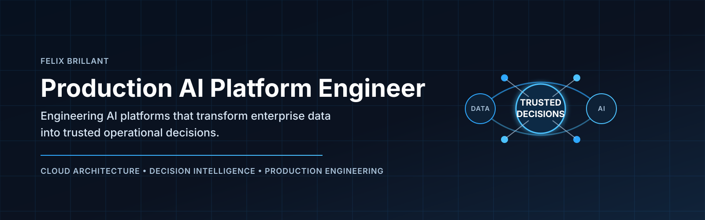
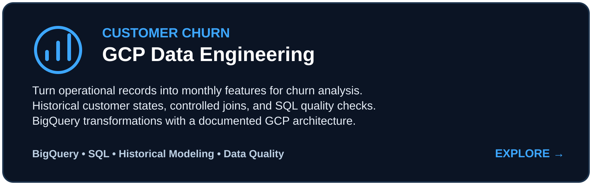
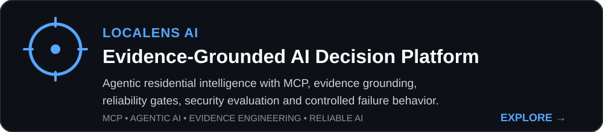
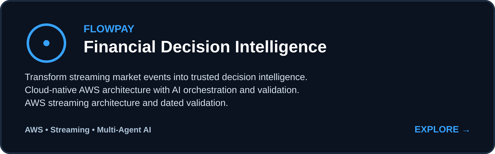
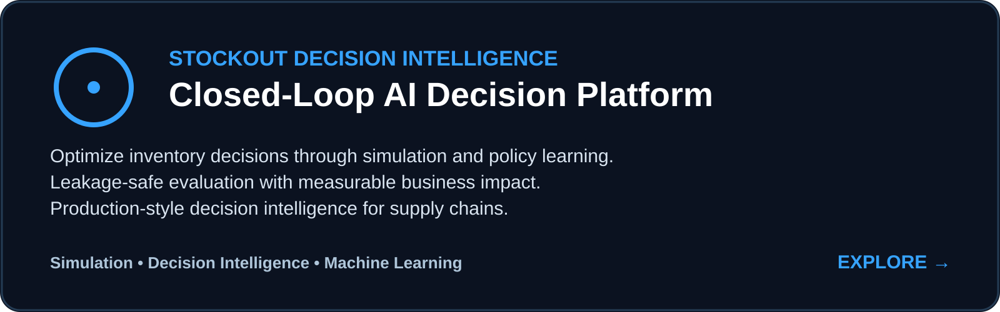
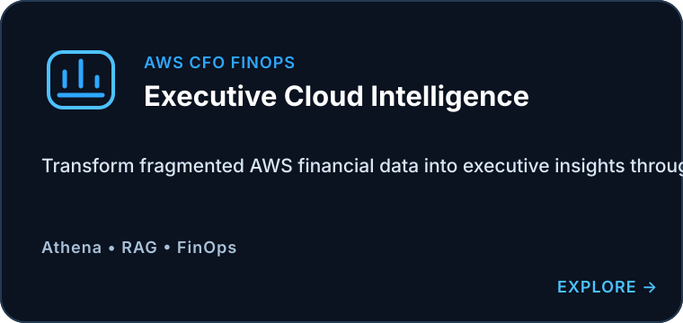
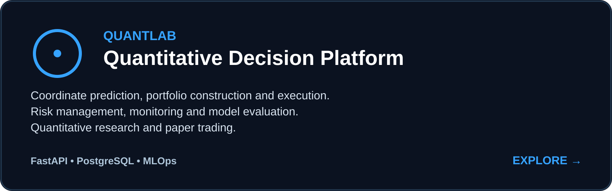
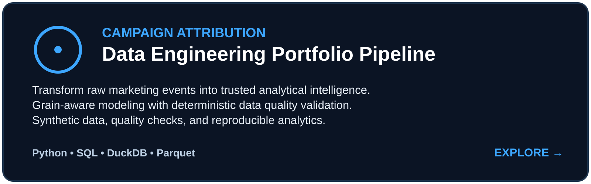
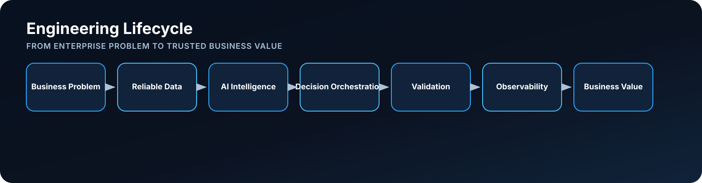
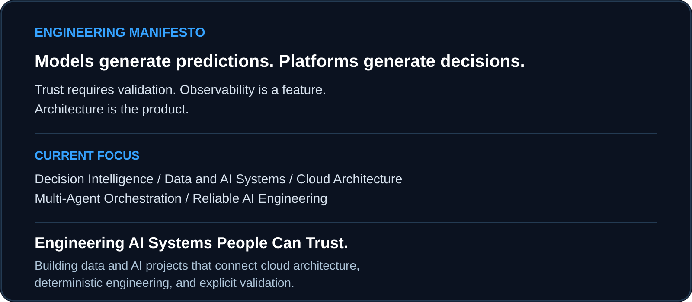

 

[Portfolio](https://xavi092000.github.io/) · [LinkedIn](https://www.linkedin.com/in/felix-brillant-27b890113/) · [Repositories](https://github.com/xavi092000?tab=repositories)

## Featured projects

 

 

 

 

 

 

Engineering Philosophy

